<!-- HemangOS profile README · theme matches https://hemang-rathod.vercel.app -->

<p align="center">
  <a href="https://hemang-rathod.vercel.app/">
    
  </a>
</p>

<p align="center">
  <a href="https://hemang-rathod.vercel.app/">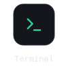</a>
  <a href="#about"></a>
  <a href="#skills"></a>
  <a href="#projects">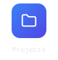</a>
  <a href="#mobile">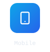</a>
  <a href="#stats">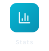</a>
  <a href="#timeline">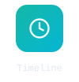</a>
  <a href="#timeline"></a>
  <a href="#contact"></a>
  <a href="https://hemang-rathod.vercel.app/"></a>
</p>

<p align="center">
  <sub>Tap an app to open it · want the real OS? <a href="https://hemang-rathod.vercel.app/"><b>boot HemangOS ↗</b></a> — terminal, desktop & mobile modes</sub>
</p>

<p align="center">
  <a href="https://hemang-rathod.vercel.app/"></a>
  
  
</p>

<br/>

<a name="about"></a>


<p align="center">
  
</p>

I'm **Hemang Rathod**, a Senior Full Stack Developer who builds enterprise **ERP, CRM, and cloud reporting systems** end to end — from data model to deployment. Over **7+ years** I've shipped order-management platforms, multi-vendor e-commerce systems, biometric workforce tools, and Power BI–driven analytics for teams that depend on the software actually working, not just demoing well.

<br/>

<a name="skills"></a>


<p align="center">
  
</p>

| `~/dir` | `ls` |
|---|---|
| `~/frontend` | React · Next.js · Angular · TypeScript · JavaScript · Tailwind CSS |
| `~/backend` | C# · .NET Core · Web APIs · Entity Framework · Node.js · SignalR · Microservices |
| `~/mobile` | Flutter · Dart · React Native |
| `~/data` | SQL Server · Azure SQL · PostgreSQL · MySQL · GraphQL · Supabase |
| `~/cloud` | Azure · AWS · CI/CD · Vercel |
| `~/power-platform` | Power BI · Power Apps · Power Automate · Power Pages · SharePoint · Dataverse |
| `~/ai` | Claude · Prompt Engineering · LLM Integration · Agentic AI |

<br/>

<a name="projects"></a>


#### `▸ enterprise & client work`

<p align="center">
  <a href="https://hemang-rathod.vercel.app/">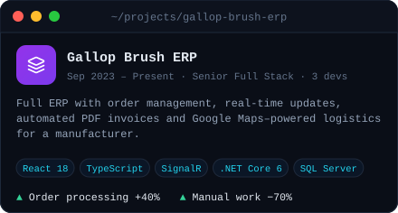</a>
  <a href="https://hemang-rathod.vercel.app/">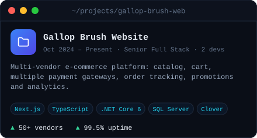</a>
  <a href="https://elite-report.vercel.app/">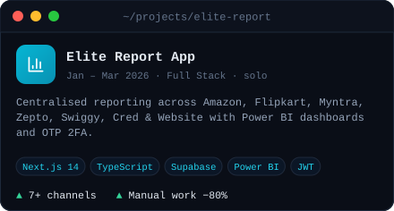</a>
  <a href="https://hemang-rathod.vercel.app/">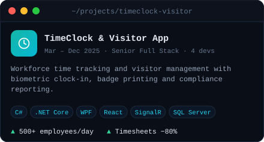</a>
  <a href="https://hemang-rathod.vercel.app/">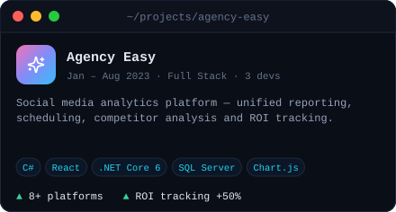</a>
  <a href="https://hemang-rathod.vercel.app/">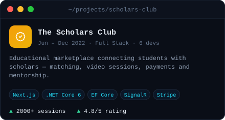</a>
  <a href="https://hemang-rathod.vercel.app/">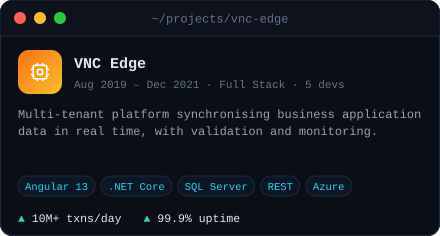</a>
</p>

#### `▸ open source`

<p align="center">
  <a href="https://github.com/Hemang67/Anuvaad-App">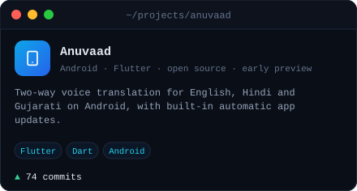</a>
  <a href="https://github.com/Hemang67/NondhAI">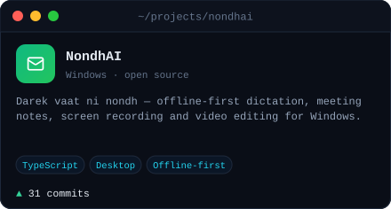</a>
  <a href="https://github.com/Hemang67/QAgent">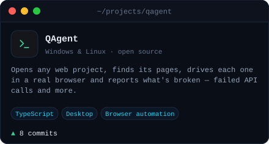</a>
  <a href="https://github.com/rathodkutumb-commits/HisabMitra">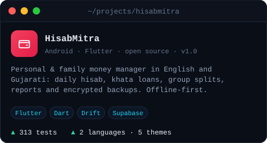</a>
</p>

<br/>

<a name="mobile"></a>

<table>
  <tr>
    <td width="42%" align="center">
      
    </td>
    <td width="58%">
      <h3>📱 Anuvaad <sup><code>early preview</code></sup></h3>
      <p>Two-way <b>voice translation</b> for <b>English ⇄ Hindi ⇄ Gujarati</b> on Android.</p>
      <ul>
        <li>🛠️ Built with <b>Flutter &amp; Dart</b> (Android 10+)</li>
        <li>🔄 Installed copies <b>update themselves</b> when a new release is published</li>
        <li>🎨 Languages, themes and auto-update ready — translation features landing next</li>
      </ul>
      <p>
        <a href="https://anuvaad-app.vercel.app/download"></a>
        <a href="https://github.com/Hemang67/Anuvaad-App"></a>
      </p>
      <p><b>Also on mobile:</b> <a href="https://github.com/rathodkutumb-commits/HisabMitra"><b>HisabMitra</b></a> — English/Gujarati family money manager (Flutter) · React Native — and my portfolio itself boots a full <b>mobile shell</b> on phones.</p>
    </td>
  </tr>
</table>

<br/>

<a name="stats"></a>

<p align="center">
  
  
</p>

<p align="center">
  
</p>

<p align="center">
  
</p>

#### `▸ both accounts` &nbsp;—&nbsp; [@Hemang67](https://github.com/Hemang67) (personal & open source) · [@HR-Techovarya](https://github.com/HR-Techovarya) (Techovarya)

<p align="center">
  
  
</p>

<details>
<summary><b><code>$ git log --stat --all-accounts</code></b> &nbsp;—&nbsp; commit summary <sub>(snapshot · 16 Nov 2026)</sub></summary>
<br/>

| Repository | Account | Language | Commits |
|---|---|---|---:|
| [Anuvaad-App](https://github.com/Hemang67/Anuvaad-App) | Hemang67 | Dart | 74 |
| [NondhAI](https://github.com/Hemang67/NondhAI) | Hemang67 | TypeScript | 31 |
| [QAgent](https://github.com/Hemang67/QAgent) | Hemang67 | TypeScript | 6 |
| [MovieAppTBD](https://github.com/Hemang67/MovieAppTBD) <sub>(fork)</sub> | Hemang67 | JavaScript | 4 |
| [task-list-app](https://github.com/Hemang67/task-list-app) | Hemang67 | CSS | 3 |
| [Movie](https://github.com/Hemang67/Movie) | Hemang67 | JavaScript | 2 |
| [Hemang67](https://github.com/Hemang67/Hemang67) <sub>(profile)</sub> | Hemang67 | Markdown | 1 |
| [HR-Techovarya](https://github.com/HR-Techovarya/HR-Techovarya) <sub>(profile)</sub> | HR-Techovarya | Markdown | 2 |
| **Total** | **Both accounts** | | **123** |

| Public contributions | 2020 | 2023 | 2024 | 2026 | **All-time** |
|---|:---:|:---:|:---:|:---:|:---:|
| @Hemang67 | 2 | 3 | – | 138 | **143** |
| @HR-Techovarya | – | – | 1 | 3 | **4** |
| **Combined** | 2 | 3 | 1 | 141 | **147** |

</details>

<br/>

<a name="timeline"></a>

```diff
@@ experience @@
+ 2019-06 → now    Sr. Software Engineer · Techovarya Solutions
                   Leading full-stack projects, scalable web apps & third-party API integrations
                   (.NET Core · React · TypeScript · cloud)
+ 2019-01 → 04     Software Development Intern · WovVTech (Technocompass Consulting)
                   Where it started — JavaScript, HTML/CSS, Node.js, React

@@ education @@
+ 2017 → 2019      MCA · G.H. Patel P.G. Dept. of Computer Science & Technology
+ 2014 → 2017      BCA · Maharaja Krishnakumarsinhji Bhavnagar University

@@ certifications @@
+ 2026-04-21       Anthropic · AI Fluency: Framework & Foundations
+ 2026-04-16       Anthropic · Claude Code in Action
+ 2022-03-07       Microsoft Certified · Power Platform Fundamentals
```

<br/>

<a name="contact"></a>


<p align="center">
  <a href="mailto:hemangrathod081@gmail.com"></a>
  <a href="https://www.linkedin.com/in/hemang-rathod-211a56134/"></a>
  <a href="https://hemang-rathod.vercel.app/"></a>
  <a href="https://github.com/HR-Techovarya"></a>
</p>

<p align="center">
  
</p>

<br/>

<p align="center">
  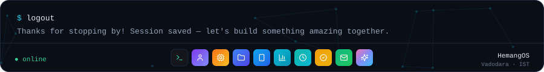
</p>
